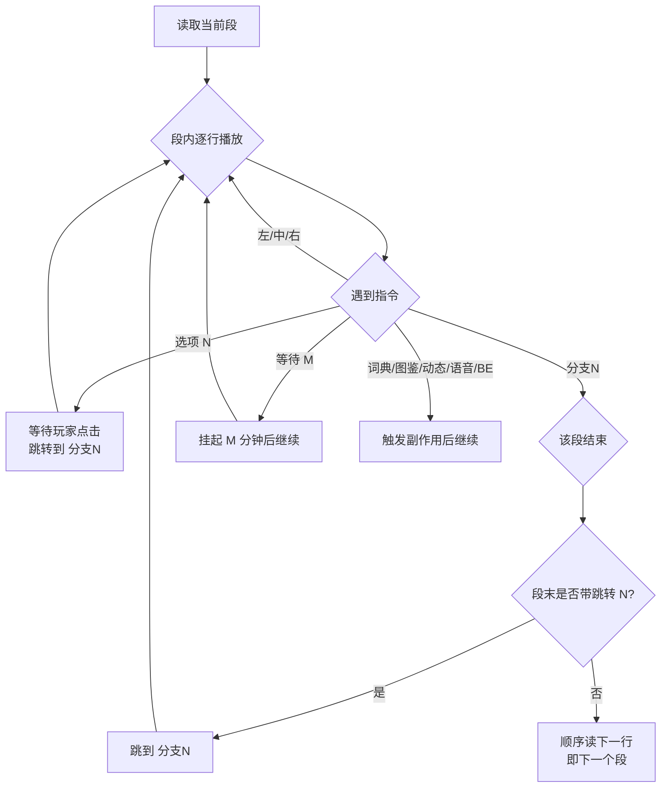

# 《异次元通讯·次元复苏》1.5.4 逆向分析报告

> 分析对象：`异次元通讯-次元复苏-release-1.5.4.apk`（36,717,735 字节）
> 分析方式：纯静态逆向（不运行 APK、不联网访问应用服务器）
> 报告日期：2026-11-06
> 工作区：`C:\03_Github\reverse\异次元通讯-次元复苏-1.5.4\`

---

## 0. 结论摘要

这是一款 **Flutter（Dart AOT）** 写的「聊天式」文字冒险游戏：Android 侧只是一个 Flutter 壳加若干原生插件，**全部游戏逻辑与剧情都在 `libapp.so` 里**，**全部剧本以明文 CSV 放在 `assets/story/`**。剧本使用一套自研的极简指令语言（全库只有 **18 种指令模式**），靠「标签 + 跳转」把线性文件组织成会话分支树。

最关键的三个发现：

1. **剧本 100% 明文可读**，共 8 个 CSV、14,401 行、153,233 个汉字，导出的可读剧本与结构化 AST 已放在 `04_资源分析\剧本\` 与 `04_资源分析\剧本AST\`。
2. **指令语法已完全解出**：`说话人,文本,指令` 三列；指令集合为 `左/中/右`（气泡方向）、`分支N`（段结束兼标签）、裸数字 `N`（跳转）、`选项,N`（玩家选项）、`等待,N`（等待 N **分钟**）、`词典`、`图鉴`、`动态`、`语音`、`BE`、`无`。所有 **2,556 处跳转全部可解析、零悬空**，语法闭合性得到验证。
3. **词典的 111 个词条名在剧本 CSV 里，释义正文硬编码在 `libapp.so`**（UTF-16LE 的 Dart 常量），其中 20 条可用「释义里出现词条名」自证配对，其余因 Dart 快照未反序列化而无法确定 id 归属。

其余值得记录的：签名是**自签名证书**（v1+v2，无 v3），证书 DN 已被编码破坏成替换字符；应用声明了 `REQUEST_INSTALL_PACKAGES`；全部资源名被百分号编码以规避中文路径问题；剧情含 **39 个 BE（坏结局）**、**15,471 分钟（约 258 小时）** 的刻意等待，是「生命线 / Lifeline」类实时叙事的典型设计。

原始数据里有 **2 处结构性缺陷**（图鉴键写错列、行尾多逗号），已修正并留档；修正不触碰剧情文本，原件副本仍完整保留。详见 [5.5 节](#55-数据缺陷与修正) 与 [`修正记录.md`](../04_资源分析/修正记录.md)。

---

## 1. 样本与工作区

### 1.1 样本指纹

| 项 | 值 |
|---|---|
| 文件名 | `异次元通讯-次元复苏-release-1.5.4.apk` |
| 大小 | 36,717,735 字节（35.01 MiB） |
| SHA-256 | `BAB21D7DBD8D8C0E5E3C879726BD5B5A54BF63B05184AE117CD4EB0DA1C6D0F3` |
| 包名 | `com.autumnmoon.miko` |
| versionName / Code | `1.5.4` / `1` |
| minSdk / targetSdk / compileSdk | 21 / 34 / 34 |
| 应用名 | 异次元通讯-次元复苏 |

> 同目录下的 `生命线.apk`（12.8MB）未在本报告范围内。

### 1.2 工作区结构（文件管理约定）

```
reverse\异次元通讯-次元复苏-1.5.4\
├─ 00_工具\            自写解析/导出脚本（24 个 .py，全部纯标准库）
├─ 01_原始\            APK 原件副本（只读，不修改）
├─ 02_解包\            ZIP 原样解包（315 条目 → 314 文件＋目录）
├─ 03_反编译\          清单/、dex/、libapp 字符串语料（ASCII + UTF-16 + 清洗后中文）
├─ 04_资源分析\        剧情CSV\（原件副本，只读）、剧情CSV_修正\（下游唯一输入）、
│                     剧本\（可读 Markdown）、剧本AST\（JSON）、表\（CSV）、统计\、修正记录.md
├─ 05_报告\            本报告
└─ 99_临时\            中间输出、日志（可随时删除）
```

原则：`01_原始` 永不改写；`02_解包` 与 APK 一一对应（不在其中改名）；`剧情CSV\` 是从 APK 里取出的**只读证据**，任何修正都产生新目录 `剧情CSV_修正\` 并留下 `修正记录.md`；一切「解读结果」只落在 `03/04/05`；可重复生成的中间态放 `99_临时`。

---

## 2. 安装包结构

### 2.1 体积构成

APK 共 **315 个 ZIP 条目**，解压后 **65,477,439 字节**（62.44 MB），压缩后 36,664,539 字节（34.97 MB，整体压缩率 56%）。

| 顶层路径 | 条目 | 解压后字节 | 占比 |
|---|---|---|---|
| `lib/` | 6 | 46,059,636 | 70.3% |
| `assets/` | 119 | 14,675,110 | 22.4% |
| 根目录文件 | 5 | 3,074,210 | 4.7% |
| `res/` | 138 | 1,560,678 | 2.4% |
| `META-INF/` | 40 | 77,881 | 0.1% |
| `kotlin/` | 7 | 29,924 | 0.0% |

体积 Top：

| 条目 | 解压后字节 |
|---|---|
| `lib/x86_64/libflutter.so` | 11,768,080 |
| `lib/arm64-v8a/libflutter.so` | 10,714,752 |
| `lib/armeabi-v7a/libflutter.so` | 7,534,416 |
| `lib/armeabi-v7a/libapp.so` | 5,620,308 |
| `lib/x86_64/libapp.so` | 5,243,808 |
| `lib/arm64-v8a/libapp.so` | 5,178,272 |
| `assets/.../music/oldBgm.ogg` | 3,382,143 |
| `classes.dex` | 2,915,792 |
| `assets/.../photo/E2-04.png` | 1,703,769 |

三套 ABI 各带一份 `libflutter.so` + `libapp.so`，**包体 70% 是 Flutter 引擎的重复拷贝**——这是 Flutter 应用的典型特征，也是「三 ABI 全打包」而不是 App Bundle 的直接证据。

### 2.2 签名与证书

| 项 | 值 |
|---|---|
| 签名方案 | **v1（JAR）+ v2（APK Signing Block）**；无 v3 / v3.1 |
| v2 内容摘要 | sha256 `e13460c8…69a453`，与当前 APK 字节一致（`matches_apk=true`） |
| 证书类型 | RSA，自签名（issuer = subject） |
| 证书 SHA-256 | `48676F7C5F211E3F03BFFC361A0BC21C259FCCD602B9DF08D5ADF8C7891F79FB` |
| 序列号 | `6915914CC9E2B64B` |
| 有效期 | 2023-02-13T05:35:48Z → 2050-07-01T05:35:48Z |
| 摘要/签名算法 | SHA-256 / RSA PKCS#1 v1.5 |

证书 DN 为 `C=Unknown, ST=…, L=…, O=…, OU=…, CN=…`，但**中文字段已被编码破坏**：DER 里存的是 U+FFFD 替换字符（`EF BF BD`），例如 ST 的实际字节是 `EF BF BD E3 B6 AB CA A1`——原始的「广东省」在生成密钥库时就被转码毁掉了，无法还原。

**结论**：这是开发者用本地自建 keystore 打的 release 包，没有走 Play 签名，也没有 v3/轮换谱系。2023 年 2 月生成的证书与 1.5.4 版本的一致性无法从包内证明（versionCode 恒为 1）。证书字段损坏本身说明构建机 locale 为中文且未做 UTF-8 规范化。

### 2.3 打包特征

- 压缩方式：`method=8`（deflate）116 项，`method=0`（store）199 项——`.so` 与已压缩媒体（webp/ogg/png）被直接存储，属常规优化。
- **全部条目时间戳被归一化为 1981-01-01 00:00:00**（DOS 纪元最小值），说明构建链做过时间戳归零/可重复构建处理。
- 存在 `kotlin/` 元数据目录（7 个 `.kotlin_module`），说明有 Kotlin 依赖被 R8 保留元数据。
- 无 `META-INF/*.version`、无 `stamp-cert-sha256`（无 source stamp）。

---

## 3. 运行架构

### 3.1 Android 壳

`classes.dex` 只有一个 dex，规模：

| 指标 | 数量 |
|---|---|
| 字符串 | 15,792 |
| 类型 | 4,646 |
| 原型 | 7,376 |
| 字段 | 10,704 |
| 方法 | 25,477 |
| 类 | 3,666 |

类名前缀分布（Top）：`androidx/datastore/preferences`(161)、`io/flutter/embedding`(99)、`androidx/core/app`(73)、`io/flutter/plugin`(61)、`com/dexterous/flutterlocalnotifications`(46)、`androidx/media2/session`(39)、`io/flutter/view`(38)、`com/google/android`(28)、`androidx/window/*`、`androidx/browser/customtabs`；其余是 R8 混淆后的单类包（`a/a`、`a0/*`、`a1/*`…）。

**没有任何游戏业务类**。也就是说：Java/Kotlin 层只负责（1）启动 FlutterEngine、（2）提供插件通道、（3）AndroidX 基础能力。逆向游戏逻辑必须回到 `libapp.so`。

清单组件：

| 组件 | 说明 |
|---|---|
| `com.autumnmoon.miko.MainActivity` | 唯一 Activity，`exported=true`，`launchMode=singleTop`，MAIN/LAUNCHER |
| `io.flutter.plugins.urllauncher.WebViewActivity` | url_launcher 内置 WebView，`exported=false` |
| `androidx.startup.InitializationProvider` | authorities `com.autumnmoon.miko.androidx-startup`，含 `ProcessLifecycleInitializer`、`ProfileInstallerInitializer` |
| `androidx.profileinstaller.ProfileInstallReceiver` | 受 `android.permission.DUMP` 保护 |

`application` 为 `android.app.Application`（非自定义类），`appComponentFactory=androidx.core.app.CoreComponentFactory`，`meta-data flutterEmbedding=2`。清单里**没有广告 SDK、统计 SDK、推送 SDK 的组件**。

### 3.2 Dart AOT 快照

`identify_flutter_build` 与 `inspect_dart_aot` 的结果：

| 项 | 值 |
|---|---|
| ABI | arm64-v8a / armeabi-v7a / x86_64 |
| Dart 快照哈希 | `80a49c7111088100a233b2ae788e1f48`（三 ABI 一致） |
| `libapp.so`（arm64） | 5,178,272 字节，sha256 `980a6583…` |
| 工具链 | clang 17.0.2（Android NDK r27 系） |
| 快照段 | `_kDartVmSnapshotData` @512/16,032；`_kDartVmSnapshotInstructions` @1,310,720/92,944；`_kDartIsolateSnapshotData` @16,576/1,250,880；`_kDartIsolateSnapshotInstructions` @1,403,712/3,747,072 |
| 格式 | data 段 magic 有效、kind=3（FullAOT）；instructions 段 magic 无效 → 覆盖率为 partial |

`libflutter.so` 内没有 `dart_version` 字符串，无法直接给出 Dart SDK 版本。REA 的 Dart AOT 读取器只支持 Dart 2.14 FullAOT 布局，因此**没有做类/函数级恢复**；这也是本报告在「词典释义 id 归属」上止步的原因。

### 3.3 插件清单（从 `libapp.so` 常量与 dex 交叉确认）

| 插件 | 用途 | 证据 |
|---|---|---|
| `just_audio` + `audio_session` + `android_audio_manager` + `just_audio_cache` | 语音/BGM 播放与缓存 | `com.ryanheise.just_audio.*`、`just_audio_cache` 通道名 |
| `flutter_local_notifications` | 本地通知（"对方已上线"提醒） | `dexterous.com/flutter/local_notifications` |
| `shared_preferences` | 存档/开关（键前缀 `flutter.`） | Pigeon 通道 `SharedPreferencesApi.*` |
| `path_provider` | 目录定位 | `PathProviderApi.getApplicationSupportPath` |
| `url_launcher` | 外链跳转 | `UrlLauncherApi.launchUrl` / `openUrlInApp` |
| `image_gallery_saver_plus` | 保存图片到相册 | 通道名 `image_gallery_saver_plus` |
| `package_info` / `window_manager` | 版本号、窗口（桌面版复用） | `dev.fluttercommunity.plus/package_info`、`packages/window_manager` |

`window_manager` 的存在说明同一份 Dart 代码也用于桌面端（Windows/macOS），Android 包只是其中一次构建。

---

## 4. 资源体系

`assets/flutter_assets/assets/` 下 **107 个文件 / 12,890,152 字节（12.29 MB）**，全部为中文文件名（ZIP 内百分号编码）。

| 目录 | 文件数 | 字节 | 内容 |
|---|---|---|---|
| `chapter/` | 8 | 122,852 | 章节封面，1080×440 webp（番外一/番外二/第一章…第六章） |
| `dictionary/` | 3 | 24,692 | 词典页 UI 素材：`词典.webp` 80×80、`词典展示.webp` 1166×1920、`未解锁词典.webp` 448×100 |
| `icon/` | 13 | 59,090 | 头像 1–8（160×160）、`Lily.webp`、`未知用户.webp`、`icon.webp` 216×216、logo `异次元通讯.webp` 255×72、`次元复苏.webp` 255×56 |
| `images/` | 9 | 1,609,690 | 聊天背景（png 1079×1920 + webp）、菜单背景 1080×1920、`聊天页/动态页/图鉴页/章节页/词典页.webp`（1080×1918，即 UI 设计稿截图）、`0.webp` 274×368 |
| `music/` | 8 | 3,920,785 | 语音 5 条（0.8–4.6 s）+ `bgm.ogg` 19.9 s + `button.ogg` 0.5 s + `oldBgm.ogg` 195.7 s（3.38 MB） |
| `photo/` | 58 | 6,536,717 | 剧情插画：`E1-01…E2-04`（事件）、`S1-01…S6-07`（章节）、`W1-01…W1-10`（某系列）、节日彩蛋 4 张、`S1-01-n` 变体、`E2-04.png` 1440×1920 |
| `story/` | 8 | 616,326 | 剧情 CSV（见第 5 章） |

插画尺寸几乎都是 **1440×1920**（部分 1280×1920、`W1-06` 达 3000×4000），全部 webp 有损压缩，单张 20–200 KB。

`res/`（138 个文件，1.56 MB）名字已被 R8 混淆成 `O8.png`、`ya.xml` 之类；93 个 PNG + 44 个二进制 AXML 布局。最大 `O8.png` 1440×1920（1.39 MB）应为启动/占位大图。`AndroidManifest` 引用的主题是 `@7f0c0000`，对应某个混淆后的 style。

其它：`fonts/MaterialIcons-Regular.otf`（1,645,184）、`shaders/ink_sparkle.frag`（Flutter 默认墨水飞溅着色器）、`AssetManifest.json/bin`、`NOTICES.Z`。

---

## 5. 剧情引擎（核心）

### 5.1 外层格式

- 每个章节一个 CSV：`assets/story/番外一.csv`、`番外二.csv`、`第一章.csv` … `第六章.csv`（ZIP 内是百分号编码名）。
- 编码 **UTF-8 无 BOM**，行尾 **CRLF**，**标准 CSV 引号规则**：第三列含逗号时整列加双引号，例如

```csv
我,在的,"右,选项,7"
```

- 每行三列：`说话人,文本,指令列表`。指令之间用逗号分隔，指令可以没有（空串表示纯空行）。

第一列（说话人）的取值规律：

| 取值 | 含义 |
|---|---|
| `Miko` / `Iris` / `Lily` / `未知用户` | NPC 昵称（对应 `icon/` 下同名头像） |
| `我` | 玩家 |
| 空 | 系统发言（配合 `中`）或该行不显示说话人 |
| 图片键（`E1-01`、`S1-01`） | 与 `动态` 指令搭配，表示动态配图 |
| 数字（`1`、`40`） | 与 `词典` 指令搭配，表示词条编号 |

### 5.2 指令全集（全库仅 18 种模式）

| # | 模式 | 行数 | 语义 |
|---|---|---|---|
| 1 | `左` | 5,640 | NPC 消息，气泡靠左 |
| 2 | （空） | 2,786 | 空行 / 视觉分隔 |
| 3 | `右,选项,N` | 2,556 | 玩家选项；选择后跳转到「以 `分支N` 结尾的段」 |
| 4 | `左,分支N` | 1,627 | NPC 消息，且**本段结束**，标签 N |
| 5 | `中` | 766 | 系统消息（"对方已上线/下线"等），居中 |
| 6 | `中,N,等待,M` | 359 | 系统文本 + **等待 M 分钟**；N 多为 0（无跳转），少数是跳转标签 |
| 7 | `左,N` | 115 | NPC 消息 + 段内跳转标签 N |
| 8 | `左,N,分支M` | 113 | NPC 消息 + 本段结束（标签 M）+ 跳到 N |
| 9 | `词典` | 111 | 解锁词典条目（第一列=编号，文本=词条名） |
| 10 | `中,分支N` | 105 | 系统消息且段结束 |
| 11 | `右` | 80 | 玩家消息（非选项） |
| 12 | `图鉴` | 43 | 解锁图鉴（文本=图片键） |
| 13 | `BE` | 39 | 坏结局标记（整行通常是 `BE,BE,BE`） |
| 14 | `动态` | 34 | 发布动态（第一列=图片键，文本=正文） |
| 15 | `无` | 20 | 无气泡小标题，文本为 `Day1`…`Day4` |
| 16 | `中,N` | 3 | 系统消息 + 跳转 |
| 17 | `语音` | 2 | 语音消息，文本即 `assets/music/<文本>.ogg` 文件名 |
| 18 | `右,N` | 2 | 玩家消息 + 跳转 |

### 5.3 执行模型：跳转表而非顺序播放

文件**不是**按阅读顺序排列的，而是「一堆以 `分支N` 收尾的段」+「一张跳转表」。执行模型可写成：



单行内「副作用」与「控制流」可以并存，例如 `左,8,分支7` 表示：显示这条 NPC 消息 → 本段结束（标签 7）→ 跳到标签 8。

**「段间推进」还有一个未完全确定的环节**。番外一第 40/41 行是相邻的两个单行答案块：

```csv
40: , 那就好 , 左,分支24
41: , 我这边没事啦 , 左,分支26
```

若引擎在答案块结束后「顺序读下一行」，选了 24 的玩家会接着看到 26 的回答。因此引擎必然还有一条「兄弟答案块只由跳转进入、顺序推进时跳过」的规则。这条规则的具体形式（按选项组跳过、还是按标签集合跳过）**无法从数据唯一确定**，需要反编译解释器才能确认；本报告的段/跳转模型只覆盖到「目标解析」这一层，而这一层已经由 0 悬空跳转充分验证。

**语法闭合性验证**（脚本 `00_工具\branch_topo.py`、`dup_labels.py`）：

| 章节 | 唯一标签 | 分支段 | 重复标签 | 无选项的纯跳转目标 | 悬空跳转 |
|---|---|---|---|---|---|
| 番外一 | 44 | 45 | 1 (`233`) | 9 | 0 |
| 番外二 | 45 | 46 | 1 (`94`) | 6 | 0 |
| 第一章 | 199 | 205 | 3 (`444`,`848`,`936`) | 8 | 0 |
| 第二章 | 261 | 263 | 1 (`1280`) | 23 | 0 |
| 第三章 | 388 | 396 | 2 (`293`,`952`) | 45 | 0 |
| 第四章 | 365 | 372 | 6 (`582`,`638`,`639`,`776`,`803`,`869`) | 48 | 0 |
| 第五章 | 185 | 185 | 0 | 7 | 0 |
| 第六章 | 333 | 333 | 0 | 41 | 0 |
| **合计** | **1,820** | **1,845** | **14** | **187** | **0** |

- **零悬空跳转**：所有 `选项N`、裸数字 `N` 都能在同章找到对应的 `分支N`。这条闭合性证明指令语义的解出是正确的——如果 `分支N` 不是标签，必然出现大量无法解析的跳转。
- **187 个「纯跳转目标」**：有 `分支N` 但没有 `选项N` 指向它，说明它们只是**汇合点**（多条支线在此合流），不是选项答案。
- **14 个重复标签**：同一标签收尾了两个段（如第四章 `582`）。这 14 个标签**全部**被跳转指向过（1–14 次），因此严格说存在歧义。两种可能：(a) 引擎取「从当前位置向后最近的 `分支N`」；(b) 引擎总是取文件中的第一处。考虑到第五章/第六章的重复标签为 0、前四章明显是手写数据，我倾向 (a)，但**这是推断，需要运行时验证**。

### 5.4 关键语义的判据

| 结论 | 证据 |
|---|---|
| `等待` 单位 = **分钟** | 文本"预计10小时"配 `等待,600`、"预计14小时"配 `840`、"预计4小时"配 `240`、"预计5分钟"配 `5`；取值 1–840 全覆盖 |
| `选项N` → `分支N` | 番外一 2 个选项 `选项,7`/`选项,10` → 第 9 行 `左,8,分支7`、第 11 行 `左,11,分支10`；两条回答各自落位 |
| 段可交错、文件非顺序 | 番外一第 13 行 `左,分支8` 出现在"答错"支线（第 9–12 行）之后，说明第 8 段与第 10 段交替存放 |
| `BE` = 坏结局 | 39 处，且 `libapp.so` 里有设置文案「BE：Bed Ending（坏结局）…开：进入BE后会自动跳出继续后续剧情 / 关：进入BE后需要重开当天剧本」；运行中还提示「你已进入BE路线, 点击我选择跳转某天」 |
| `无` = 章节内日期分隔 | 20 处，文本恒为 `Day1`…`Day4`，且每章数量与该章天数吻合（第 1/2/3/5 章各 3 个，第 4/6 章各 4 个）；`无` 的字面含义是「不显示气泡」，即只渲染一行居中的日期小标题 |
| `动态` 是独立于对话的社交页 | 34 条，正文如「决定了！今天要做一件大事！」，配图键与 `photo/` 同名 |
| `语音` 直接引用音频文件 | 2 条：`哈哈哈，我是天才`、`走在未知的道路上，不许停也不能回头`，`assets/music/` 下同名 `.ogg` 均存在 |

### 5.5 数据缺陷与修正

原始 CSV 里有 **2 处结构性缺陷**，会导致解析结果失真，已修正；修正不触碰任何剧情文本，且原始副本仍完整保留作为证据。修正后的文件在 `04_资源分析\剧情CSV_修正\`，逐条记录见 [`修正记录.md`](../04_资源分析/修正记录.md)。

| 章节 | 行 | 修正前 | 修正后 | 修正理由 |
|---|---|---|---|---|
| 第六章 | 106 | `S6-01-n,,图鉴` | `,S6-01-n,图鉴` | 图鉴键写进了第一列，导致解析出空键，`S6-01-n` 实际解锁不出来 |
| 第四章 | 760 | `,S4-01-n,图鉴,` | `,S4-01-n,图鉴` | 行尾多一个逗号（第 4 个空字段），属手改残留 |

其余 6 个文件与原件 SHA-256 完全一致。解析器同时做了两处健壮化，使它对这类脏数据免疫：

- **键取「前两列中最后一个非空字段」**：图鉴行因此有 29 行「静默解锁」(`键,,图鉴`) 与 14 行「角色发图」(`Miko/Iris,键,图鉴`) 两种形态，后者除解锁外还会在聊天里把这张图作为图片消息发出（`Miko` 13 次、`Iris` 1 次）。修正前，这 14 行的键会被误读成 `Miko`/`Iris`。
- **词典编号按「有则取、无则空」处理**：111 条词典行中 88 条带编号、23 条只写词条名。

语义层的数据异常（改动会破坏语义，**只登记不改值**）：

1. `词典` 编号有 26 个空洞：缺 `2–25`、`27`、`38`。编号是 `libapp.so` 里释义数组的下标，重排会破坏 id→释义 映射。
2. 编号 `39` 同时用于 `uno`（番外二）与 `Tango One`（第二章），而 id 39 的释义经自证匹配为 **Tango One**——`uno` 复用了错误编号，是原作缺陷；改成别的编号只会指向另一条错释义，故保留原值。
3. 编号 `44` 重复用于 `熵`（第三章 248/258 行），两条同名同义，属重复解锁，无实际影响。
4. 图鉴键大量带 `-n` 后缀（如 `S4-01-n`），磁盘上只有 `S1-01-n.webp` 一个 `-n` 文件。对账后 19 个 `-n` 键**全部**能对应到存在的基名图片，可判定渲染规则是「找 `-n` 文件，缺失则回退基名」；`-n` 的语义（新版/和谐版/高清版）仍未确定。
5. `BE` 行有两种写法：`BE,BE,BE`（31 处）与 `,,BE`（8 处），语义相同。
6. 词典表新增 `稳定键`（`章节:行号`）与 `编号状态`（正常/重复/空编号）两列，让 23 条无编号词条也能被唯一定位。

---

## 6. 内容统计

### 6.1 规模

| 章节 | 行数 | 消息 | 选择点 | 选项 | 分支段 | 等待合计(分) | 词典 | 图鉴 | 动态 | 语音 | BE | Day |
|---|---|---|---|---|---|---|---|---|---|---|---|---|
| 番外一 | 311 | 177 | 27 | 54 | 45 | 81 | 1 | 3 | 2 | 1 | 0 | 0 |
| 番外二 | 350 | 197 | 32 | 64 | 46 | 56 | 4 | 2 | 3 | 0 | 0 | 0 |
| 第一章 | 1,630 | 850 | 171 | 342 | 205 | 1,710 | 21 | 6 | 3 | 0 | 8 | 3 |
| 第二章 | 2,076 | 1,210 | 184 | 368 | 263 | 1,810 | 15 | 7 | 6 | 0 | 9 | 3 |
| 第三章 | 2,882 | 1,635 | 264 | 528 | 396 | 2,539 | 22 | 6 | 3 | 1 | 11 | 3 |
| 第四章 | 2,697 | 1,621 | 230 | 460 | 372 | 4,269 | 20 | 6 | 6 | 0 | 7 | 4 |
| 第五章 | 1,622 | 999 | 136 | 272 | 185 | 1,751 | 15 | 6 | 5 | 0 | 2 | 3 |
| 第六章 | 2,833 | 1,764 | 234 | 468 | 333 | 3,255 | 13 | 7 | 6 | 0 | 2 | 4 |
| **合计** | **14,401** | **8,453** | **1,278** | **2,556** | **1,845** | **15,471** | **111** | **43** | **34** | **2** | **39** | **20** |

文本量：CSV 共 616,326 字节，其中 **153,233 个汉字**。

### 6.2 结构特征

- **所有选择点都是二选一**（1,278 个选择点 × 2 = 2,556 个选项），无三选项、无自由输入。这是刻意保持的移动端交互极简。
- **15,471 分钟等待 ≈ 258 小时**（10.7 天纯等待），单次最长 840 分钟（14 小时）。等待与剧情内文本严格对应（"预计N小时"→N×60），说明这是「实时陪伴」设计的核心机制，不是随机延迟。
- 39 个 BE 集中在前四章（第一章 8、第二章 9、第三章 11、第四章 7），第五章/第六章各仅 2 个——后期收敛到主线。
- 20 个 `Day` 标记：番外无日期，第 1–3、5 章各 3 天，第 4、6 章各 4 天，整体跨约 20 天。
- 每章开头都是「对方已上线」+ 一句寒暄（`莫西莫西～`、`哈喽！`、`喂！有人看得到吗？`、`hi！你还在吗？`、`阿ho噶！`、`你好...`、`hi`、`嘿...你在吗？`）。

### 6.3 叙事对象

- 主线通过一个聊天软件和 **Miko**（莫西莫西→莫西→Miko）对话，另有 `Iris`、`Lily`、`未知用户` 三个可切换对象（`libapp.so` 有「切换对象中」）。
- 图鉴/动态按章节推进解锁，`S*` 为章节插画、`W1-*` 为某系列（10 张）、`E*` 为事件插画、`april/birthday/christmas/mid_autumn` 为节日彩蛋（不在图鉴表内，由彩蛋逻辑触发）。
- `libapp.so` 里存在「你已触发彩蛋, 本次启动解锁全部词典和图鉴，下次进入重置为原解锁进度」——**存在一个全解锁彩蛋**。

---

## 7. 词典 · 图鉴 · 动态 · 语音

### 7.1 词典：111 条，名字在 CSV、释义在 `libapp.so`

- 词条名来自 CSV，共 **111 条**，分布：第一章 21、第二章 15、第三章 22、第四章 20、第五章 15、第六章 13、番外一 1、番外二 4。
- 编号体系：`0,1,26,28–37,39–63,64–111`，共 **86 个不同编号**，缺 `2–25`、`27`、`38`；重复见 5.5。
- 释义正文**不在 CSV**，而是以 Dart 常量（UTF-16LE）编在 `libapp.so` 里。用启发式清洗后得到 **98 个释义文本块**（`03_反编译\dart_释义候选.txt`），其中 **20 条**可用「释义开头就出现词条名」自证配对：

| 编号 | 词条 | 释义开头（节选） |
|---|---|---|
| 47 | NPC | NPC是non-player character的缩写，是游戏中一种角色类型… |
| 60 | 克莱因瓶 | 克莱因瓶，在数学领域中是指一种无定向性的平面… |
| 61 | 傅科摆 | 傅科摆是一个单摆，底板有一个量角器… |
| 70 | 时序保护 | 时序保护猜想（Chronology protection conjecture）是由霍金提出的… |
| 77 | 约拿 | 约拿，是古以色列国的先知，前往亚述帝国首都尼尼微城传天谴警告… |
| 85 | 包豪斯 | 包豪斯的风格就是构成艺术。由几何形体以及特定的排列形式… |
| 86 | 蔓越莓 | 蔓越莓又称蔓越橘，是杜鹃花科越橘属…的常绿小灌木矮蔓藤植物… |
| 91 | 朋克 | 朋克（Punk），又译为庞克，诞生于七十年代中期… |
| 99 | 中枢神经 | 中枢神经系统（英文名称：Central Nervous System…）是由脑和脊髓组成… |
| 101 | 梅尔克修道院 | 梅尔克修道院(StiftMelk)是一座本笃会修道院，成立于1089年… |
| 108 | 裙撑 | 是法语洛可可式横向裙撑的音译。 |
| 111 | 《美丽新世界》 | 《美丽新世界》… |
| 28 | lo娘茶会 | 指Lolita洋装爱好者的聚会… |
| 39 | Tango One | Tango One探戈一号是一部快节奏的犯罪惊悚片… |
| 80 | lily | lily，英语单词，名词、形容词… |
| 52 | 注会 | 注会…（文本块被噪声截断） |
| 35 | 守望pg | 守望pg…（文本块被噪声截断） |
| — | JK制服 / Miko / 《傅科摆》 | 命中但属**误配**（该块讲的是别的词条，例如"Miko"块实际解释的是「皮尔斯」教堂） |

完整表见 `04_资源分析\表\词典释义_匹配.md` / `.csv`（含置信度「强/弱/未匹配」）。

**为什么剩下的 80 条无法自动配对**：Dart 的字符串池按「代码首次引用顺序」排布，不按词典 id 排序；而多数释义正文不重复词条名（例如 `塞尔提` 的释义以"史特路尔森，轻小说无头骑士异闻录…"开头，`艾丽丝` 的释义以"女性名字，读音相近的主要有Alice和Iris…"开头）。要拿到 `id → 字符串` 的表结构，必须反序列化 Dart snapshot（blutter 一类工具 + 匹配的 Dart SDK）。

语料中还有一批**设置页/帮助文案**，可直接读出玩法开关（这是剧本之外最有价值的信息）：

- `开：在系统提示对方已下线时需要等待随机时间 / 关：对方下线后立刻上线回复`
- `开：到达章节末尾自动解锁本章节未解锁图鉴和词典`
- `BE：Bed Ending（坏结局）开：进入BE后会自动跳出继续后续剧情 / 关：进入BE后需要重开当天剧本`
- `你已进入BE路线, 点击我选择跳转某天`
- `你已触发彩蛋, 本次启动解锁全部词典和图鉴，下次进入重置为原解锁进度`
- `点击Miko头像进入动态页`、`对方输入中...`、`切换对象中`、`语音开关`、`miko错字是人设`

### 7.2 图鉴：43 个解锁点 / 58 张插画

- 解锁点 43 个，键 43 个且**全部唯一**（修正列错位后不再有空键），磁盘插画 58 个文件（57 个唯一基名，`E2-04` 同时有 `.webp` 与 `.png`）。
- 键名规律：`章节字母+序号`，`S`=章节场景、`E`=事件、`W1`=系列、后缀 `-n` 为变体。
- **两种解锁形态**：29 行是纯解锁（`键,,图鉴`），14 行带发送者（`Miko,键,图鉴` 13 次、`Iris,键,图鉴` 1 次），后者会在聊天里把这张图当作对方发来的图片消息一并显示。
- 对账结果（`00_工具\tujian_reconcile.py`）：**24 个键有同名文件**；**19 个键缺同名文件，且这 19 个全部是 `-n` 结尾、基名图片都存在**（如 `S4-01-n` → `S4-01.webp`）。据此可以确定 `-n` 变体的加载规则是**回退到基名**，而不是依赖不存在的文件——这解释了为什么包里只有 `S1-01-n.webp` 一张 `-n` 图。
- **资源闭合性很好**：57 张插画中，只有 4 张节日彩蛋（`april`/`birthday`/`christmas`/`mid_autumn`）既不在图鉴也不在动态里（属隐藏内容），其余 53 张都被剧情引用；图鉴负责「精选场景」，动态负责「角色日常」，分工清晰。

### 7.3 动态与语音

- **动态 34 条**：相当于剧中角色的社交主页，每条 = 图片键 + 正文，正文是角色口吻的自白（例："我改变不了这个世界，只能改变我自己"）。是叙事补充，不参与分支。
- **语音 2 条**：仅番外一与第三章各 1 条，走 `just_audio` 播放 `assets/music/*.ogg`。

---

## 8. 网络与隐私面

### 8.1 网络行为

`libapp.so` 中只有 **11 个 URL/邮箱常量**，`dart:_http`、`HttpClient` 相关符号存在但**没有任何埋点/统计/广告域名**：

| 常量 | 用途 | 备注 |
|---|---|---|
| `https://www.subrecovery.top` | 官网/关于页 | HTTPS |
| `https://www.subrecovery.top/privacy.html` | 隐私政策 | HTTPS |
| `https://www.taptap.cn/app/378027` | TapTap 页面 | HTTPS |
| `https://www.bilibili.com/blackboard/activity-mikoapril.html` | 愚人节活动页 | HTTPS |
| `https://www.3839.com/a/156008.htm` | 外部介绍页 | HTTPS |
| `http://qm.qq.com/cgi-bin/qm/qr?...&group_code=465805687` | 加 QQ 群 | **明文 HTTP** |
| `http://q1.qlogo.cn/g?b=qq&nk=` | 拉取 QQ 群头像 | **明文 HTTP** |
| `https://api.flutter.dev/...`、`https://flutter.dev/docs/...` | Flutter 框架内置报错链接 | 非业务 |

结论：**没有第三方数据回传**（无 Firebase/友盟/穿山甲等），网络面基本只有「外链跳转」+「拉一张 QQ 头像」。两个 `http://` 明文请求是唯一的安全瑕疵（可被中间人替换头像/群链接）。

### 8.2 权限

| 权限 | 风险说明 |
|---|---|
| `INTERNET`、`ACCESS_NETWORK_STATE` | 拉头像、外链 |
| `REQUEST_INSTALL_PACKAGES` | **高风险**：声明了安装 APK 的能力，静态看没有代码使用，但属敏感权限，容易被应用市场拒审 |
| `REQUEST_IGNORE_BATTERY_OPTIMIZATIONS`、`WAKE_LOCK`、`FOREGROUND_SERVICE` | 保证「定时上线/等待提醒」在后台存活 |
| `POST_NOTIFICATIONS`、`VIBRATE` | 本地通知 |
| `com.autumnmoon.miko.DYNAMIC_RECEIVER_NOT_EXPORTED_PERMISSION` | 自定义 signature 级权限，AndroidX 动态注册接收器用 |

**没有**读取存储、通讯录、定位、相机、麦克风权限；保存图片走 `image_gallery_saver_plus`（Android 10+ 免权限走 MediaStore）。

### 8.3 数据落盘

`shared_preferences`（键前缀 `flutter.`）保存本地状态。键名本身是 R8/常量池里的短串，未逐一恢复；结合设置文案可确定至少包含：剧情进度、已解锁词典/图鉴、三个开关（随机等待、章节末自动解锁、BE 后行为）、语音开关、当前对话对象。全部为本地文件，无账号体系、无云同步、无云端存档。

---

## 9. 复现指南

环境：Windows + Python 3.14（仅标准库）。工具都在 `00_工具\`，按依赖顺序执行：

| # | 脚本 | 作用 | 主要产物 |
|---|---|---|---|
| 1 | `unpack.py`（PowerShell 内联） | 逐条解包 APK，处理大小写冲突条目（`res/4c.xml` vs `res/4C.xml`） | `02_解包\` |
| 2 | `axml2xml.py` | 纯 stdlib 二进制 AXML → XML | `03_反编译\清单\AndroidManifest.xml` |
| 3 | `dex_inspect.py` | DEX 头/字符串/类型/方法/类统计 | `03_反编译\dex\*.txt` |
| 4 | `dart_utf16_strings.py` | 扫描 `libapp.so` 的 UTF-16LE 可打印串 | `03_反编译\dart_strings_utf16.txt/.json` |
| 5 | `dart_corpus.py` | 用「中文标点/高频字 + 汉字占比」过滤噪声 | `03_反编译\dart_中文文案_清洗.txt`、`dart_释义候选.txt` |
| 6 | **`csv_fix.py`** | **CSV 体检 + 2 处结构性缺陷修正**，原件只读、修正另存 | `04_资源分析\剧情CSV_修正\`、`修正记录.md` |
| 7 | `story_export.py` | 修正版 CSV → 可读剧本 / JSON AST / 6 张表 / 统计 | `04_资源分析\剧本\`、`剧本AST\`、`表\`、`统计\` |
| 8 | `branch_topo.py`、`dup_labels.py` | 分支标签拓扑、重复标签、悬空跳转校验 | 控制台/`99_临时` |
| 9 | `dict_tujian.py` | 词典/图鉴与资产文件对账 | `99_临时\dict_tujian.txt` |
| 9b | `tujian_reconcile.py` | 图鉴键 ↔ `photo/` 文件逐条对账（验证 `-n` 回退规则） | 控制台 |
| 10 | `dict_match.py` | 释义块 ↔ 词条自证匹配 | `表\词典释义_匹配.md/.csv` |
| 10b | `story_sim.py` | 段/跳转模型静态模拟（用两种标签策略穷举，用于反证，结论未采信） | `99_临时\story_sim.txt` |
| 11 | `asset_inventory.py` | 资产清单（SHA-256、webp/png 尺寸、ogg 时长） | `表\资源清单.csv/.md` |
| 12 | `apk_manifest.py` | ZIP 条目清单、目录聚合、证书 RDN | `表\APK条目清单.csv` |
| 13 | `url_scan.py` | URL/邮箱/插件通道常量扫描 | `99_临时\url_scan.txt` |

三个容易踩的坑：

- **AXML 属性结构**必须按 `<iIIHBB` 解 (ns, name, raw, size, res0, dataType)，数据在 +16 处的 u32；元素头是 `<iIHHH`。字段错位会得到看似成功但其实全是 0 的解析结果。
- **Dart AOT 里搜中文必须先转 UTF-16LE**：`选项`/`分支`/`等待` 等词 UTF-8 搜 0 命中、UTF-16LE 各命中 3–9 次。另外扫描 UTF-16LE 会产生大量「把 ASCII 串按 UTF-16 读出来」的倒字噪声（22,349 条里只有 274 条是干净中文），必须过滤。
- **CSV 取键不能写死列号**：`图鉴` 行的键可能落在第 1 或第 2 列，取「前两列最后一个非空」才对；同理 `词典` 行的编号可能为空。写死 `row[1]` 会静默产生空键/错键，且不会报错——这正是原始数据的两处缺陷直到对账时才暴露的原因。

---

## 10. 未解问题

1. **词典 `id → 释义` 的完整映射**：需要 Dart snapshot 反序列化（blutter + 对应 SDK 版本）；当前只有 20 条自证配对。
2. **重复 `分支` 标签的解析策略**：14 个重复标签全部被跳转到，需要运行时观察究竟取「最近的下一个」还是「第一个」。
3. **`-n` 后缀的语义**：加载规则已确定为「缺 `-n` 文件则回退基名」，但 `-n` 本身表示新版、和谐版还是别的变体，需要看美术素材差异才能确定。
4. **`libapp.so` 中剧情解释器的实现细节**：段索引如何构建（预扫描还是运行时查找）、答案块之间的推进/跳过规则、BE 后「跳到某天」的天数映射表、随机等待的上下限。曾用静态模拟器（按两种标签解析策略穷举）复现，段覆盖率只有 4%–63% 且 39 个 BE 只命中 3 个，反证了「纯标签跳转 + 顺序读下一行」不足以解释数据——必须有「兄弟答案块跳过」之类的额外规则，因此该模拟器未作为结论产出。
5. **`REQUEST_INSTALL_PACKAGES` 是否被真正使用**：静态扫描未发现 `PackageInstaller` 调用，可能只是模板残留。
6. **26 个 `词典` 编号空洞（2–25、27、38）**：是早期版本删条目留下的，还是这些 id 由代码动态分配，未知。
7. **三 ABI 的 `libapp.so` 内容差异**：仅确认快照哈希一致，未做逐个函数的二进制比对。

---

## 附录 A：产物清单

| 路径 | 内容 |
|---|---|
| `03_反编译\清单\AndroidManifest.xml` | 解码后的清单 |
| `03_反编译\dex\{strings,classes,methods,fields,summary}.txt` | DEX 各表 |
| `03_反编译\dart_strings_ascii.txt` | `libapp.so` 的 ASCII 串（23,584 条） |
| `03_反编译\dart_strings_utf16.txt` / `.json` | UTF-16LE 原始串（90,238 条，含噪声） |
| `03_反编译\dart_中文文案_清洗.txt` | 清洗后唯一中文串（274 条） |
| `03_反编译\dart_释义候选.txt` | 12–400 字的释义/文案块（98 条） |
| `04_资源分析\剧情CSV\` | 从 APK 取出的 8 个剧本 CSV **原件副本（只读证据）** |
| `04_资源分析\剧情CSV_修正\` | 修正 2 处结构性缺陷后的剧本 CSV（**下游唯一输入**，6 个文件与原件逐字节相同） |
| `04_资源分析\修正记录.md` | 修正清单（含字节级前后对照、SHA-256）+ 语义层异常登记 + 数据体检 |
| `04_资源分析\剧本\{番外一,番外二,第一章…第六章}.md` | 可读剧本（含分支跳转标注） |
| `04_资源分析\剧本AST\*.json` | 结构化剧情（事件数组，供二次开发/统计） |
| `04_资源分析\表\词典.csv` / `图鉴.csv` / `动态.csv` / `语音.csv` / `章节天数.csv` / `BE节点.csv` | 六张业务表（词典含 `稳定键`、`编号状态`；图鉴含 `发送者`） |
| `04_资源分析\表\词典释义_匹配.md/.csv` | 词条 ↔ 释义匹配（含置信度） |
| `04_资源分析\表\资源清单.csv/.md` | 107 个资产的大小/尺寸/时长/SHA-256 |
| `04_资源分析\表\APK条目清单.csv` | 315 个 ZIP 条目明细 |
| `04_资源分析\统计\剧情结构统计.md` | 章节规模统计表 |
| `05_报告\逆向分析报告.md` | 本报告 |
| `存档清单.md`（工作区根） | 存档时点的文件清单与 SHA-256，以及后续待办 |

## 附录 B：术语

- **段（segment）**：以 `分支N` 收尾的一串连续行，是跳转的最小单位。
- **标签（label）**：`分支N` 里的 N，既是段的结束标记，也是跳转目标。
- **纯跳转目标**：只有 `分支N`、没有 `选项N` 指向的标签，即多支线汇合点（187 个）。
- **BE**：Bed Ending，坏结局；触发后可选择「跳到某天」重开。
- **Day 标记**：`无` 指令 + `DayN` 文本，章节内的日期分隔。
